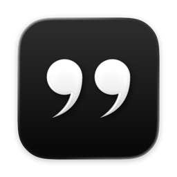
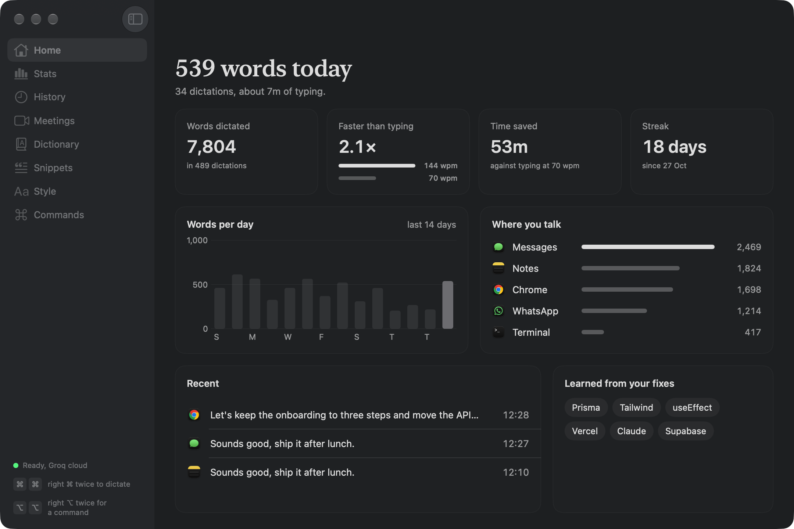
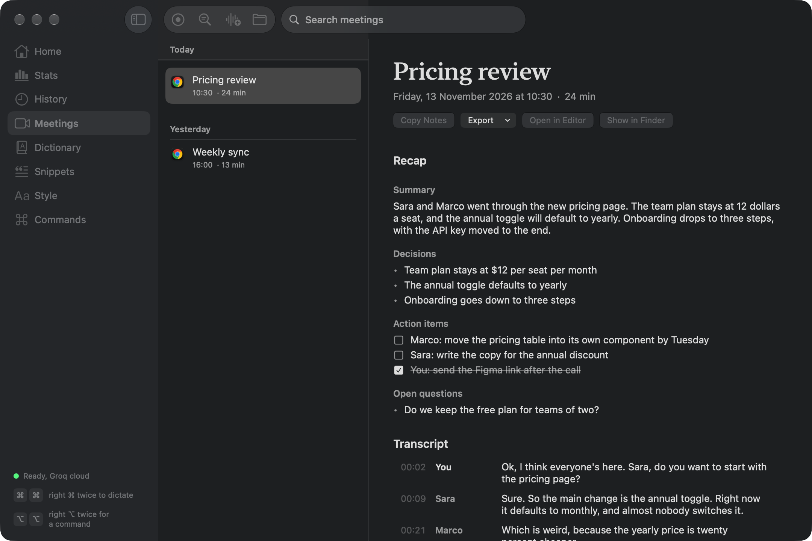
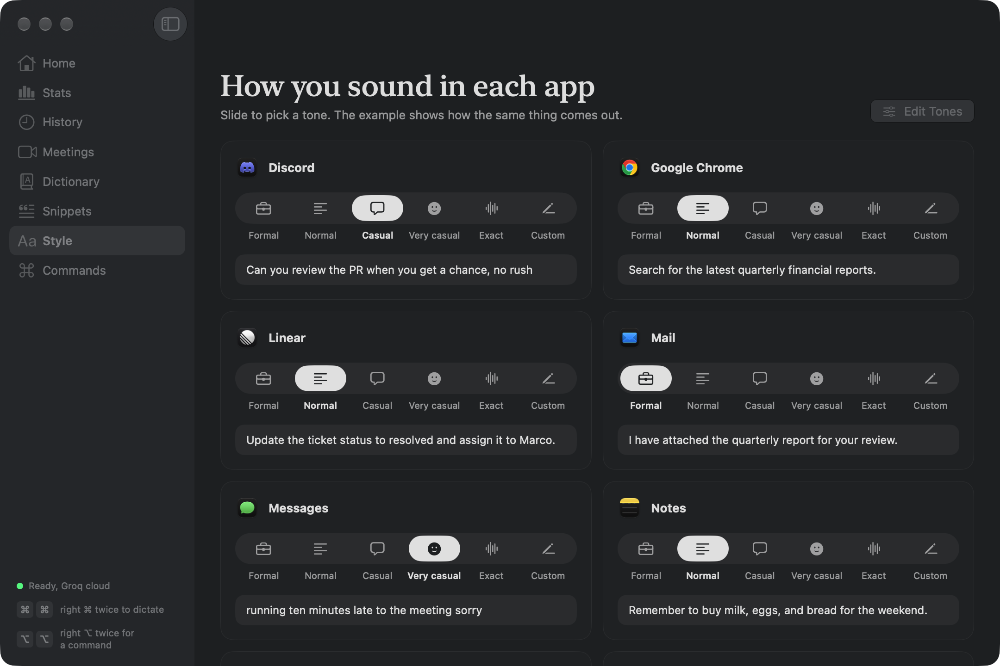
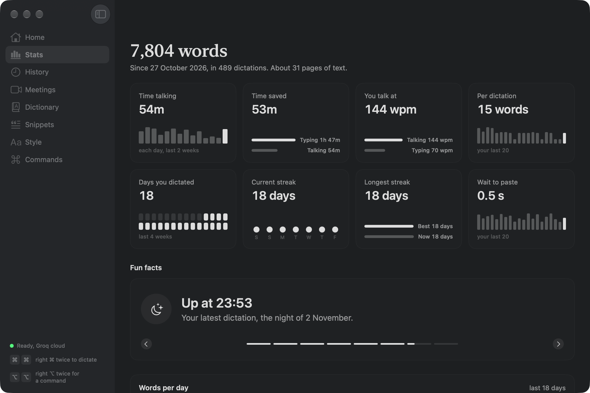

<div align="center">



# Verbatim

**Talk anywhere on your Mac. The text lands where you're typing.**

A native macOS dictation app. Tap a key, speak in English or Italian, tap again,<br>
and clean text is pasted at your cursor. It also takes meeting notes without a bot joining the call.

[](#requirements)
[](https://swift.org)
[](project.yml)

</div>

<p align="center">
  
</p>

---

## Features

- **Dictate into any app.** Double-tap right `⌘`, talk, tap right `⌘` again. The text is pasted where your cursor is. The left `⌘` stays free for normal shortcuts.
- **Cleaned to fit the app.** Filler words go, punctuation goes in. Each app gets its own tone (Formal, Normal, Casual, Exact or your own), so Slack and Mail don't read the same.
- **Commands.** Double-tap right `⌥` to rewrite the selected text, open apps and sites, search, or run your own saved commands ("bullets", "reply", "standup").
- **Ask about the screen.** With nothing selected, `⌥⌥` and "reply saying Thursday works" writes the reply at your cursor, using what's on screen. Ask a question ("what does this error mean") and the answer shows in a small panel.
- **Translate.** Double-tap right `⇧` and speak Italian to paste English, or the other way round.
- **Fast.** Audio is compressed before upload, and long dictations are sent in parts at your natural pauses, so only the last bit is left when you stop.
- **Online or fully on your Mac.** Groq's Whisper by default. Download Parakeet or Whisper large v3 turbo in Settings to run speech on the Mac, and Apple Intelligence cleans up the text there, as a backup or for everything.
- **Meeting notes, no bot.** Notices when Zoom, Meet, Teams, Webex, FaceTime, Slack or Discord starts a call and offers to take notes, or starts them by itself if you want. It hears the call app and your mic as two sides, writes the transcript as it goes, tells the other voices apart, and adds a recap (summary, decisions, action items, open questions) when the call ends. Names come out right more often: Parakeet checks your Dictionary, the people invited in Calendar and the names on Google Meet's video tiles against the audio, and Claude can fix misheard names after the call. In Google Meet with captions on, each sentence gets the name of who said it. Without captions, Claude works out who's who from the conversation. Voices you've named are recognised in later meetings. Fix any line of the transcript by hand, move it to another speaker, or merge two speakers. Export any meeting as Markdown, text or PDF.
- **Transcribe a recording.** Drop an audio or video file on Meetings and it becomes a meeting with a transcript, speakers and a recap.
- **Ask your meetings.** "What did we decide about pricing?" Claude reads your notes and transcripts and answers with links to the meetings.
- **Learns your words.** A Dictionary of names and terms, filled in by itself when you fix a word it got wrong.
- **Words as you talk** (off by default). Your words appear in a card on the pill while you speak, grey until they settle, already formatted.
- **Format by voice.** Say "new line", "bullet", "comma" or "question mark" ("a capo", "virgola" in Italian). End with "send" and it presses Return too.
- **Snippets.** Say "my email" and get your email.
- **Backup.** Meetings, history, Dictionary, snippets and settings in one zip, from Settings → General.
- **History and Stats.** Every dictation with the app it went into and the engine that wrote it, plus words per minute, time saved and a few fun facts.
- **Pill or Notch.** Status shows as a small glass pill at the bottom of the screen, or drops down from the notch.

## Screens

**Meetings.** The recap and the transcript, with names, after a call.



**Style.** A tone for each app, with an example of how the same thing comes out.



**Stats.** Words, speed, streaks and a few fun facts.



The screens use sample data. `make shots` makes them again.

## Usage

| Action | How |
|---|---|
| Start dictating | Double-tap right `⌘` |
| Stop and paste | Tap right `⌘` |
| Cancel | `Esc` |
| Command | Double-tap right `⌥`, speak, tap right `⌥` |
| Translate | Double-tap right `⇧`, speak, tap right `⇧` |
| Take meeting notes | **Take Notes** on the call pill, or from the menu bar |
| Open Verbatim | Menu bar icon. Pages are `⌘1` to `⌘8`. |
| Settings | `⌘,` |

## Pages

| Page | What's there |
|---|---|
| **Home** | Today's words, time saved and your speaking speed |
| **Stats** | Words over time, speed, apps you dictate into, fun facts |
| **History** | Every dictation, searchable, with the app and engine |
| **Meetings** | Calls by day, with the recap and the transcript (You, Person 1, Person 2… click a name to rename it) |
| **Dictionary** | Words and names it should always get right |
| **Snippets** | Short phrases that expand into longer text |
| **Style** | The tone for each app, with examples and editable instructions |
| **Commands** | Your saved commands and your own sites to open and search |

## Speech engines

| Engine | Where it runs | Notes |
|---|---|---|
| Groq, Whisper large v3 turbo | Online | Default. Needs a free Groq key. |
| Parakeet | This Mac | 630 MB download. About 0.1 s per sentence. |
| Whisper large v3 turbo | This Mac | 630 MB download. 1 to 3 s per sentence, uses your Dictionary as hints. |
| Apple speech | This Mac | Built in. Last resort when offline. |

Cleanup and meeting recaps use a Groq language model, or **Apple Intelligence** on the Mac. Apple's model is lighter: punctuation and filler words, with your words kept as they are.

**Settings → Speech → Speech goes to** picks *Groq first* (the Mac takes over when you're offline, Groq is slow or out of free requests) or *Only this Mac* (speech, cleanup and recaps never leave the Mac).

## Install

Verbatim uses [XcodeGen](https://github.com/yonaskolb/XcodeGen), so the `.xcodeproj` isn't in the repo.

```bash
brew install xcodegen
git clone https://github.com/filippocappa/verbatim.git
cd verbatim
make install      # Release build into /Applications, then launch
```

`make run` builds and launches a Debug copy instead.

Add your [Groq](https://console.groq.com/keys) key in **Settings → Speech**. For name fixes in meeting notes, add an [Anthropic](https://console.anthropic.com/settings/keys) key in **Settings → Meetings**. Both are stored in the Keychain.

> [!IMPORTANT]
> On first launch Verbatim asks for **Microphone** and **Accessibility** (to paste and read the selection). Meeting notes also need **Screen & System Audio Recording**, only to hear the call app.

> [!TIP]
> Build with your **Apple Development** identity (set in `project.yml`). With ad-hoc signing, macOS treats every rebuild as a new app and asks for the permissions again.

### Requirements

- macOS 26 or later
- Xcode 27 / Swift 6
- A free Groq API key, or a local model downloaded in Settings

## How it works

```
right ⌘ ×2 ──▶ mic ──▶ compress ──▶ Groq Whisper ──▶ cleanup (Groq, tone per app) ──▶ paste
                          │              │
                          │              └─ slow or offline ─▶ Parakeet / Whisper on the Mac / Apple
                          │                                     then cleanup with Apple Intelligence
                          └─ after 15 s, earlier parts are sent at each pause
```

1. **Listen.** The mic records while you talk. After 15 seconds, the audio so far is sent at your next pause, so the end goes faster.
2. **Transcribe.** Groq's Whisper gets the compressed audio. If it doesn't answer in time, or there's no internet, a local engine takes over and the pill says so. The limit is 2.5 to 6 seconds with Parakeet downloaded, 5 to 12 without, longer for longer dictations.
3. **Clean up.** The text goes to a Groq language model with the tone set for the app you're in and your Dictionary. If the speech came from the Mac, or Groq fails, Apple Intelligence cleans it up on the Mac instead.
4. **Paste.** It's pasted at your cursor and saved to History.

Meetings use a Core Audio process tap to hear only the call app, plus the mic. Both sides are transcribed about every 25 seconds, with Parakeet on the Mac when it's downloaded (Groq otherwise), into a Markdown file in **Documents → Verbatim Meetings**. A small CTC model checks the names from the Dictionary and Calendar against the audio of each piece. When the call ends, FluidAudio's speaker models tell apart the voices on the other side (from a temporary file, deleted right after). Voices you've named are kept as voice prints (numbers, not audio) and matched in later meetings. With an Anthropic key, Claude then fixes misheard names in the transcript, and the recap is written. No audio is saved.

## Project structure

| Folder | Responsibility |
|---|---|
| `App/` | Entry point, menu bar and window setup |
| `Core/` | Dictation and meeting controllers, live words, spoken formatting, backup, settings, stats, styles, permissions |
| `Engine/` | Hotkeys, recording, Groq, Claude, local speech, Apple speech, system audio tap, call detection, Calendar, voices, screen reading, pasting |
| `UI/Main/` | The main window pages |
| `UI/Pill/` | The pill and the notch island |
| `UI/Settings/` · `UI/Onboarding/` · `UI/MenuBar/` | Settings, first launch, menu bar menu |
| `Resources/` | Info.plist, entitlements, app icon, start and stop sounds |

## Dependencies

- [FluidAudio](https://github.com/FluidInference/FluidAudio) for Parakeet and for telling voices apart in meetings
- [WhisperKit](https://github.com/argmaxinc/argmax-oss-swift) for Whisper on the Mac

Everything else is Apple frameworks: AppKit, SwiftUI, AVFoundation, Core Audio, Speech and Foundation Models (Apple Intelligence).

## Changelog

What's changed, in plain words: [CHANGELOG.md](CHANGELOG.md).
